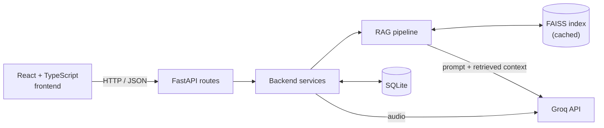

<div align="center">

# MemoAI — AI-Powered PDF Assistant

**Upload a PDF, ask questions in natural language, and get context-aware answers using semantic retrieval and a large language model.**


</div>

---

## Overview

MemoAI is a full-stack Retrieval-Augmented Generation (RAG) application. Users upload PDF documents, ask questions in plain English, and receive answers generated by an LLM from the most relevant passages of the document. Conversations are saved, so follow-up questions keep their context. The app can also transcribe audio files.

The project covers the whole pipeline end to end: PDF text extraction, chunking, local embeddings, vector search, prompt construction, LLM inference, persistence, a REST API, and a web client.

## Key Features

- **PDF question answering:** upload a PDF and ask questions about its content
- **Custom document processing pipeline:** text extraction with PyMuPDF, then chunking
- **Semantic retrieval:** Sentence Transformer embeddings (`all-MiniLM-L6-v2`) searched with FAISS
- **Context-aware responses:** retrieved passages and recent chat history are sent to a Groq-hosted LLM (`llama-3.3-70b-versatile`)
- **Conversation history and persistence:** conversations are stored in SQLite
- **Audio transcription:** Groq's `whisper-large-v3-turbo`
- **Cached vector indexes:** a document's index is built once and reused
- **Typed REST API:** FastAPI with auto-generated interactive docs
- **Modern frontend:** React 19, TypeScript, Vite, Tailwind CSS

## Architecture



### Document ingestion pipeline


### Question-answering pipeline


## Technology Stack

| Layer | Technology |
|---|---|
| **Backend** | Python, FastAPI, Uvicorn, Pydantic |
| **PDF parsing** | PyMuPDF (`fitz`) |
| **Embeddings** | Sentence Transformers, `all-MiniLM-L6-v2` (runs locally) |
| **Vector search** | FAISS (`faiss-cpu`) |
| **LLM** | Groq API, `llama-3.3-70b-versatile` |
| **Audio transcription** | Groq API, `whisper-large-v3-turbo` |
| **Database** | SQLite |
| **Frontend** | React 19, TypeScript, Vite, Tailwind CSS, Axios, React Markdown |

## Design Decisions

**FAISS instead of a hosted vector database.** FAISS runs inside the application process, so there is no extra service to deploy or pay for. For a single-node project with per-document indexes, this keeps setup simple. The trade-off is that it does not provide a managed, multi-instance vector store.

**Local embeddings with Sentence Transformers.** `all-MiniLM-L6-v2` is a small, widely used model that runs on CPU. Embedding happens locally, so there is no per-request embedding cost and document text is not sent to an external service for that step.

**Groq for LLM inference.** Groq provides hosted open-weight models behind a simple API, and the same account covers both text generation and Whisper transcription. Keeping the provider call in one service layer means it can be swapped without touching the retrieval code.

**SQLite for persistence.** SQLite needs no database server and is a good fit for a single-node application. It keeps conversation history across restarts. It is not intended for heavy concurrent writes or multiple app instances.

**Cached vector indexes.** Embedding a document is the most expensive step, so each document's index is built once and reused for later questions instead of being rebuilt on every request.

**Layered backend.** Routes handle HTTP, services hold business logic, and the RAG module handles retrieval. Separating them keeps each part easier to read, test, and replace.

## Getting Started

### Prerequisites

- Python 3.10 or newer
- Node.js 18 or newer
- A Groq API key from the [Groq Console](https://console.groq.com/keys)

### 1. Clone the repository

```bash
git clone https://github.com/Abdullah-PyDev/MemoAI.git
cd MemoAI
```

### 2. Backend setup

Create and activate a virtual environment.

**Windows (PowerShell)**

```powershell
python -m venv .venv
.venv\Scripts\Activate.ps1
```

**Windows (Command Prompt)**

```cmd
python -m venv .venv
.venv\Scripts\activate.bat
```

**Linux / macOS**

```bash
python3 -m venv .venv
source .venv/bin/activate
```

Install dependencies:

```bash
pip install -r requirements.txt
```

<!-- VERIFY: requirements.txt currently lists pypdf, not pymupdf. If the code imports fitz, add `pymupdf` to requirements.txt (and remove unused packages such as streamlit). -->

Configure environment variables by creating a `.env` file in the project root:

```env
GROQ_API_KEY=your_groq_api_key_here
```

Start the backend:

```bash
uvicorn app.main:app --reload --port 8000
```

- API: http://127.0.0.1:8000
- Interactive docs (Swagger UI): http://127.0.0.1:8000/docs
- Alternative docs (ReDoc): http://127.0.0.1:8000/redoc

### 3. Frontend setup

In a second terminal:

```bash
cd frontend
npm install
npm run dev
```

Open the local URL printed by Vite in the terminal.

The frontend expects the backend at `http://localhost:8000`, the port used above. If you run the backend on a different port, update the API base URL in `frontend/src/services/`.

<!-- VERIFY: confirm where the frontend API base URL is defined and whether it reads a VITE_* environment variable. -->

## Environment Variables

| Variable | Required | Description |
|---|---|---|
| `GROQ_API_KEY` | Yes | Groq API key, used for LLM responses and audio transcription |

Never commit your `.env` file. It is excluded by `.gitignore`.

## API Reference

Base URL: `http://localhost:8000`

| Method | Path | Purpose |
|---|---|---|
| `POST` | `/upload` | Upload a PDF document for processing |
| `POST` | `/ask` | Ask a question about an uploaded document |
| `POST` | `/transcribe` | Transcribe an audio file to text |
| `POST` | `/conversation` | Create a new conversation |
| `GET` | `/conversation/{id}` | Retrieve a conversation's history |

Request and response schemas are generated by FastAPI and always match the running code. Start the backend and open [`/docs`](http://127.0.0.1:8000/docs) to see parameters and try each endpoint.

<!-- VERIFY: confirm methods and paths against app/routes (upload.py, ask_pdf.py, transcribe.py, conversation.py, system.py). system.py endpoints are not listed because they were not verified. -->

## Project Structure

```
MemoAI/
├── app/                    # FastAPI backend
│   ├── core/               # Prompts and configuration
│   ├── db/                 # SQLite database layer
│   ├── models/             # Data models and schemas
│   ├── rag/                # Retrieval pipeline and index caching
│   ├── routes/             # API endpoints
│   ├── services/           # Business logic
│   └── main.py             # Application entry point
├── frontend/               # React + TypeScript client (Vite)
├── assets/                 # Project assets
├── requirements.txt        # Python dependencies
└── README.md
```

## Known Limitations

- **Answers can be wrong.** The LLM is given retrieved passages, but retrieval can miss relevant text and the model can still produce inaccurate answers. Treat output as an aid, not a source of truth.
- **No page citations.** Answers do not currently point back to the source page or passage.
- **No OCR.** Scanned or image-only PDFs are not supported; text must be extractable.
- **No authentication.** There are no user accounts, so the app is intended for local or personal use.
- **Single-node design.** SQLite and a local FAISS cache are not suited to multiple app instances or heavy concurrent use.
- **No automated tests or CI yet.**
- **Requires internet access and a Groq API key** for LLM responses and transcription.

## Roadmap

- [ ] Show source passages and page numbers with answers
- [ ] Add automated tests and a GitHub Actions workflow
- [ ] Add a Dockerfile / Docker Compose setup
- [ ] Add authentication and per-user document isolation
- [ ] Stream responses to the UI
- [ ] Optional OCR for scanned PDFs
- [ ] Migrate to PostgreSQL (with pgvector) for multi-user deployment

## Contributing

Issues and pull requests are welcome. For larger changes, please open an issue first to discuss what you would like to change.

## License

Released under the MIT License.

## About the Author

**Abdullah Shafiq**
Python Developer | AI Applications | Backend Engineering

I'm an aspiring developer building AI-powered applications with Python and modern web technologies. MemoAI is a learning project where I worked through the full RAG stack, from document processing to a web interface.

GitHub: [@Abdullah-PyDev](https://github.com/Abdullah-PyDev)
