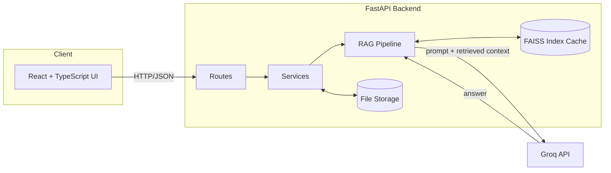

<div align="center">

# MemoAI

**Chat with your PDFs and audio. Get answers grounded in your own documents, with page references.**

A full-stack Retrieval-Augmented Generation (RAG) app: FastAPI + FAISS on the backend, React + TypeScript on the frontend.


[Live Demo](#) · [Demo Video](#) · [API Docs](#api-reference) · [Report a Bug](https://github.com/Abdullah-PyDev/MemoAI/issues)

</div>

<!--
TODO before publishing:
1. Replace the Live Demo / Demo Video links above (or delete them if you have neither).
2. Add 1-2 screenshots or a short GIF to /assets and update the paths below.
3. Add the Groq model name you use (e.g. in Tech Stack) and confirm how audio transcription is done.
-->

<p align="center">
  
</p>

---

## Overview

Reading long documents to find one answer is slow. MemoAI lets you upload a PDF, ask questions in plain English, and get answers drawn **only from your document**, with a conversation history so follow-up questions keep their context.

It also transcribes audio files, so lecture recordings and meetings can be searched the same way as documents.

**What this project demonstrates:**

- Designing and building a complete RAG pipeline: chunking, embeddings, vector search, and prompt construction
- A typed REST API with automatic OpenAPI docs (FastAPI)
- A modern React + TypeScript client talking to that API
- Conversation state management across multiple concurrent sessions

---

## Features

| Feature | Description |
|---|---|
| **PDF Q&A** | Upload a PDF and ask natural-language questions about its content |
| **Grounded answers** | Responses are generated from retrieved passages, not from the model's memory alone |
| **Multi-turn conversations** | Chat history is included in the prompt, so follow-ups like "what about the second one?" work |
| **Audio transcription** | Upload audio files and get text back |
| **Cached embeddings** | Vector indexes are cached, so a document is only embedded once |
| **Interactive API docs** | Swagger UI at `/docs`, ReDoc at `/redoc` |

---

## Architecture



### Ingestion pipeline (on upload)

```
PDF  ->  extract text (with page numbers)  ->  split into chunks
     ->  embed with Sentence Transformers  ->  store in FAISS index  ->  cache
```

### Query pipeline (on each question)

```
Question  ->  embed  ->  FAISS similarity search  ->  top-k chunks
          ->  prompt = system instructions + retrieved chunks + chat history + question
          ->  LLM  ->  answer
```

---

## Tech Stack

| Layer | Technology |
|---|---|
| **API** | Python, FastAPI, Uvicorn |
| **Retrieval** | FAISS (vector search), Sentence Transformers (embeddings), PyPDF (parsing) |
| **LLM** | Groq API (low-latency LLM inference), model: `[your-model-name]` |
| **Frontend** | React 19, TypeScript, Vite, Tailwind CSS, Axios, React Markdown |
| **Storage** | File-based document and conversation storage, cached vector indexes |

---

## Design Decisions

<!-- Fill in or adjust the "why" for each; hiring managers read this section closely. -->

- **FAISS over a hosted vector DB:** runs in-process with zero infrastructure, which is ideal for a single-node app and keeps setup to one command. [Add: what you'd switch to at scale, e.g. pgvector or Qdrant.]
- **Groq for generation:** fast inference keeps answers responsive, and the LLM sits behind a single service layer, so swapping providers means changing one module. [Add: why you chose Groq and which model.]
- **Local embeddings (Sentence Transformers):** no per-request embedding cost and documents never leave the machine for the embedding step.
- **Cached indexes:** re-embedding on every question would be slow and wasteful, so each document's index is built once and reused.
- **Layered backend (`routes` -> `services` -> `rag`):** keeps HTTP concerns separate from business logic and retrieval, so each piece can be tested and replaced independently.

---

## Getting Started

### Prerequisites

- Python 3.10+
- Node.js 18+
- A Groq API key ([get one here](https://console.groq.com/keys))

### 1. Clone

```bash
git clone https://github.com/Abdullah-PyDev/MemoAI.git
cd MemoAI
```

### 2. Backend

```bash
python -m venv .venv
source .venv/bin/activate        # Windows: .venv\Scripts\activate

pip install -r requirements.txt

cp .env.example .env             # then add your API key
uvicorn app.main:app --reload --port 8000
```

API: http://localhost:8000 · Docs: http://localhost:8000/docs

### 3. Frontend

```bash
cd frontend
npm install
npm run dev
```

Open the URL printed by Vite in your terminal.

### Environment variables

| Variable | Required | Description |
|---|---|---|
| `GROQ_API_KEY` | Yes | Groq API key |
| `SERVER_HOST` | No | Backend host (default `0.0.0.0`) |
| `SERVER_PORT` | No | Backend port (default `8000`) |
| `VITE_API_URL` | No | Backend URL used by the frontend (default `http://localhost:8000`) |

---

## API Reference

| Method | Endpoint | Description |
|---|---|---|
| `POST` | `/upload` | Upload a PDF and build its vector index |
| `POST` | `/ask` | Ask a question about an uploaded document |
| `POST` | `/transcribe` | Transcribe an audio file to text |
| `POST` | `/conversation` | Create a new conversation |
| `GET` | `/conversation/{id}` | Retrieve a conversation's history |

Full interactive documentation is available at `/docs` when the server is running.

<details>
<summary>Example request</summary>

```bash
curl -X POST http://localhost:8000/ask \
  -H "Content-Type: application/json" \
  -d '{"question": "What are the main conclusions?", "conversation_id": "abc123"}'
```

<!-- Replace with your real request/response shape. -->
</details>

---

## Project Structure

```
MemoAI/
├── app/                    # FastAPI backend
│   ├── core/               # Prompts and configuration
│   ├── db/                 # Storage layer
│   ├── models/             # Data models and schemas
│   ├── rag/                # RAG pipeline and caching
│   ├── routes/             # API endpoints (upload, ask_pdf, transcribe, conversation, system)
│   ├── services/           # Business logic
│   └── main.py             # Application entry point
├── frontend/               # React + TypeScript client (Vite)
├── assets/                 # Screenshots and static assets
├── requirements.txt
└── README.md
```

---

## Known Limitations & Roadmap

Being upfront about trade-offs:

- File-based storage is simple but not suited to multi-user, multi-instance deployment
- Scanned (image-only) PDFs are not supported without OCR
- No authentication yet

**Planned:**

- [ ] Source citations with page numbers in the UI
- [ ] Automated tests and CI (GitHub Actions)
- [ ] Docker Compose for one-command setup
- [ ] Authentication and per-user document isolation
- [ ] Swap file storage for PostgreSQL + pgvector
- [ ] Streaming responses

---

## Contributing

Issues and pull requests are welcome. Please open an issue first to discuss any significant change.

## License

Released under the [MIT License](LICENSE).

---

## About the Author

**Abdullah** | Python / Full-Stack Developer

I build AI-powered applications with Python and React, and I'm open to **remote** opportunities.

[LinkedIn](#) · [Portfolio](#) · [Email](mailto:you@example.com) · [GitHub](https://github.com/Abdullah-PyDev)
